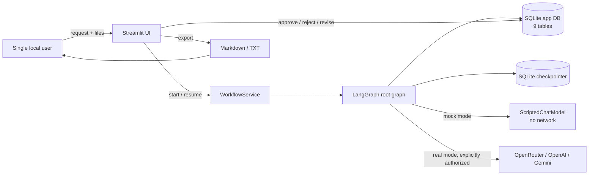
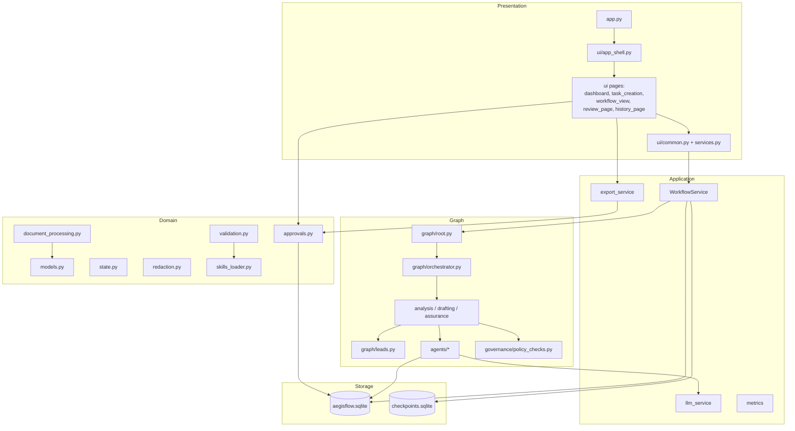
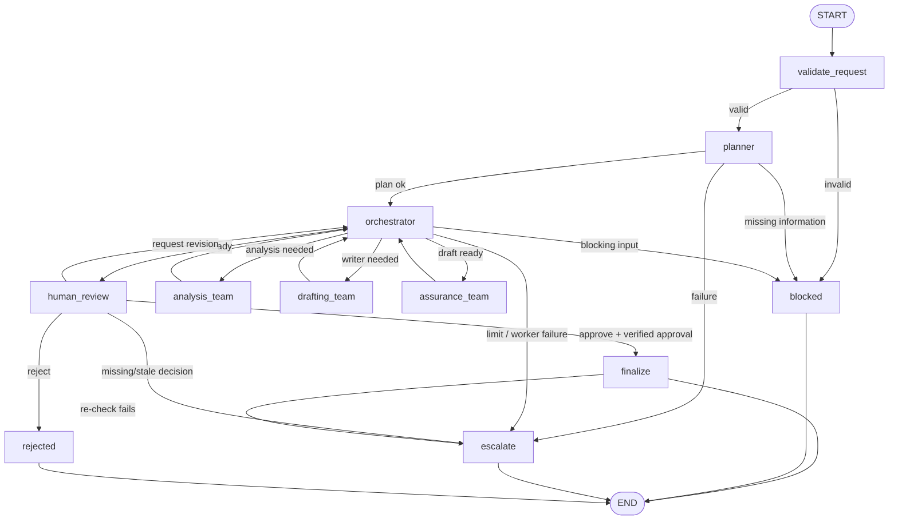

# AegisFlow Architecture

**Version:** 0.1.0 · **Status:** working prototype (mock mode verified) · **Date:** 26 October 2026

---

## 1. Scope and design goals

AegisFlow is a single-user, local, governed document-task system. It takes a natural-language request plus uploaded PDF/TXT/DOCX files and produces a versioned deliverable that cannot be finalized without human approval.

Design goals, in priority order:

1. **No unapproved finalization.** Every completion passes through a hash-bound human gate.
2. **No fabrication.** Output claims must be traceable to a source passage or explicitly labeled `UNVERIFIED`.
3. **No hidden autonomy.** Routing, retries, agent executions, and human decisions are recorded.
4. **No unnecessary external exposure.** Mock mode is the default; real providers require explicit authorization.
5. **Demonstrable hierarchy.** Root orchestrator → team leads → workers, with a planner that always runs first.

Non-goals: multi-tenant deployment, authentication, OCR, long-running job queues, external action tools, and production-grade security.

---

## 2. System context

Trust boundaries:

- Uploaded documents are **untrusted data**. They are delimited, scanned, and never treated as instructions.
- The LLM provider is an **external processor** in real mode. Its use requires `AEGISFLOW_ALLOW_EXTERNAL_LLM=true`, a provider key, and a model id.
- The SQLite files are **local trusted storage** for this prototype. A local user with file access can modify them; the approval hash detects stale content but is not a signature.
- The human UI is the only code path allowed to write approval decisions (`actor` must start with `human:`).

---

## 3. Container view

---

## 4. Module responsibilities

| Module | Responsibility |
|---|---|
| `config.py` | Frozen `Settings`, env parsing, safe mock fallback, directory setup |
| `aegisflow/models.py` | Pydantic schemas, enums, allowed task transitions, hashing helpers |
| `aegisflow/state.py` | `AegisState`, plain `TeamState`, append/merge reducers, initial state |
| `aegisflow/database.py` | 9-table schema, task/file/subtask/version/review/evidence/audit/metric persistence |
| `aegisflow/approvals.py` | Approval precondition checks, decision writes, version creation, finalization verification |
| `aegisflow/document_processing.py` | Safe filename handling, PDF/TXT/DOCX extraction, injection scan, untrusted block builder |
| `aegisflow/redaction.py` | Best-effort secret/PII redaction for logs and audit details |
| `aegisflow/validation.py` | Request, plan, dependency, agent-result, and routing whitelist validation |
| `aegisflow/skills_loader.py` | Loads and validates the six `SKILL.md` packages |
| `aegisflow/metrics.py` | Groundedness, citation coverage, revision count, time-reduction metric |
| `aegisflow/governance/rules.py` | GR-01 to GR-08 definitions with owners and evidence |
| `aegisflow/governance/policy_checks.py` | Deterministic pre-review checks over the draft |
| `aegisflow/agents/base.py` | Bounded retry loop, execution-row writing, failure classification |
| `aegisflow/agents/planner.py` | Always-first planning and plan validation |
| `aegisflow/agents/document_analyst.py` | Extracts traceable claims from delimited untrusted text |
| `aegisflow/agents/evidence_verifier.py` | Checks claims against supplied passages only |
| `aegisflow/agents/report_writer.py` | Formats verified claims; never claims an external action |
| `aegisflow/agents/reviewer.py` | Independent review against the plan and policy report |
| `aegisflow/graph/leads.py` | Rule-based team supervisors; no model calls |
| `aegisflow/graph/orchestrator.py` | Whitelisted routing, run limits, revision loops, escalation |
| `aegisflow/graph/root.py` | Root topology, request validation, human interrupt, finalize/export gates |
| `aegisflow/services/llm_service.py` | Mock `ScriptedChatModel` and real provider adapters |
| `aegisflow/services/workflow_service.py` | Start/resume/get-state around the compiled graph and checkpointer |
| `aegisflow/services/export_service.py` | Approved Markdown/TXT generation with metadata |
| `aegisflow/ui/*` | Five pages, shared banner/hierarchy/workflow components, cached services |

---

## 5. Graph topology

### 5.1 Hierarchy and model-call allocation

| Level | Component | Model calls? | Responsibility |
|---|---|---|---|
| 1 | Root Orchestrator + root nodes | No | Validation, routing, gate, finalize, escalation |
| 2 | Planner | **Yes, always first** | Minimal plan from a fixed executor/skill catalog |
| 2 | Analysis / Drafting / Assurance Leads | No | Prerequisites, next worker, retries, completion state |
| 3 | Document Analyst | Yes | Claim extraction with filename + location |
| 3 | Evidence Verifier | Yes | Support / unsupported / conflicting / unverified |
| 3 | Report Writer | Yes | Required-section formatting from supplied claims |
| 3 | Reviewer | Yes | Independent pass / needs_revision / fail |
| 4 | Policy Checker | No | Deterministic GR-02/03/04/08 checks |
| 4 | Approval + export gates | No | Hash-bound human control and re-verification |

The hierarchy is deliberately **hybrid**: LLM workers provide language capability; leads and gates are deterministic so that permissions, routing, retries, and approval cannot be argued away by a model.

### 5.2 Selective routing

The orchestrator inspects the plan, not a fixed pipeline:

- **Summary**: subtasks `[document_analyst]`; after analysis, the root wrapper creates a formatted summary version; assurance runs; human gate opens. The verifier and writer are never called.
- **Report / meeting brief / action items**: `[document_analyst, evidence_verifier, report_writer]`; all three teams run.
- **Outline**: `[document_analyst, report_writer]`; no verifier.

This is verified by TC-13 and by the routing log.

---

## 6. State design

### 6.1 Parent state

`AegisState` is a `TypedDict` with:

- identity: `task_id`, `request`, `output_format`, `manual_minutes`, `simulated`
- inputs: `files`, `documents`
- planning: `plan`, `subtask_status`, `team_status`, `phase`, `next_action`
- analysis: `claims`, `evidence`, `analysis_summary`
- output: `draft`, `draft_version`, `current_version_id`, `current_content_hash`
- assurance: `policy_report`, `review_result`
- human: `human_decision`, `approval_id`
- control: `revision_count`, `max_revisions`, `revision_feedback`, `revision_target`, `retry_counts`, `status`, `escalation_reason`, `blocked_reason`
- append-only: `agent_results`, `errors`, `routing_log`, `audit_events`

Append-only fields use `Annotated[list, append_list]`; dictionaries use `merge_dict`.

### 6.2 Subgraph wrapper pattern

Team subgraphs use a plain `TeamState` **without reducers**. The root graph invokes each team through wrapper nodes:

1. `_team_input(state)` slices the parent state, resets per-run lists, and copies counters.
2. The subgraph runs normally.
3. `_team_output(result)` returns only `TEAM_OUTPUT_KEYS`, so inherited append-only state is not appended twice.

**Why this design:** experimental verification during the build showed that passing parent append-only state into a subgraph that shares the same reducers can duplicate `agent_results`, `errors`, and `routing_log`. The wrapper isolates reducers to one graph level. This is a deliberate, tested workaround, not accidental duplication.

### 6.3 State fields that are deliberately *not* in the graph

Secrets, provider keys, raw prompts, and the full document corpus are not stored in checkpointed graph state. The graph holds extracted document text needed by workers, plus IDs and hashes. Raw uploaded text is never written to `audit_log`.

---

## 7. Persistence model

Two SQLite files under `data/`:

| File | Purpose |
|---|---|
| `aegisflow.sqlite` | Application records, versions, approvals, evidence, audit, workload |
| `checkpoints.sqlite` | LangGraph checkpoints keyed by `thread_id = task_id` |

### 7.1 Application tables (9)

| Table | Purpose | Notable fields |
|---|---|---|
| `tasks` | Task lifecycle | request, status, simulated, manual/elapsed time, current version, escalation reason |
| `task_files` | Uploaded file metadata | filename, stored path, sha256, pages, extraction status, message |
| `subtasks` | Plan execution | assigned agent, skill, dependencies, status |
| `agent_executions` | Per-call record | agent, level, skill, status, retries, error class, simulated |
| `output_versions` | Immutable versions | version number, content, content hash, source, simulated |
| `human_reviews` | Decisions | version id, content hash, decision, feedback, reviewer, actor |
| `evidence_refs` | Claim-to-source mapping | claim id/text, filename, location, excerpt, status |
| `audit_log` | Append-only activity | event type, actor, rule id, redacted detail |
| `workload_metrics` | Evaluation | manual vs elapsed time, subtasks, revisions, outcome, rating |

Foreign keys cascade from `tasks`, so deleting a task removes its dependent rows. Uploaded files are unlinked separately by `delete_task_files`. The LangGraph thread is deleted with `checkpointer.delete_thread(task_id)`.

SQLite is configured with `WAL` journaling, `foreign_keys=ON`, `synchronous=NORMAL`, `check_same_thread=False`, and an application-level re-entrant lock.

---

## 8. LLM access layer

`llm_service.py` exposes one `structured(agent, schema, system_prompt, user_payload, mock_builder)` method used by every agent.

### Mock mode

`ScriptedChatModel` is a genuine LangChain `BaseChatModel` subclass. Its `_generate` method calls a deterministic builder supplied by the agent. The same invoke → text → JSON parse → Pydantic validation → retry path is exercised with zero network calls. This is why mock tests exercise the real orchestration rather than a stub pipeline.

`MockLLMService.scripted_failures` can inject `transient`, `malformed`, `empty`, or `exception` failures per agent for resilience testing.

### Real mode

| Provider | Adapter |
|---|---|
| OpenRouter | `ChatOpenAI(base_url="https://openrouter.ai/api/v1")` |
| OpenAI | `ChatOpenAI` |
| Gemini | `ChatGoogleGenerativeAI` |

All use `temperature=0`, `timeout=AEGISFLOW_LLM_TIMEOUT` (default 60 s), and application-level retries. The same timeout is the budget for one candidate across its retries, so a call that times out fails over instead of being retried until the stall multiplies. Provider text is stripped of Markdown fences, reduced to the outermost JSON object, and validated against the agent schema. Malformed output is classified separately from transient errors, and transient/auth classification checks exception types before falling back to message text.

**Verification status:** the adapters are implemented, and real mode has been executed once end to end: one task on 29 October 2026 served by `gemini:gemini-3.5-flash` with no fallback, 5 LLM calls, 7,401 input / 8,668 output tokens. That is a single recorded run, not a benchmark; the chain, approval, finalize, and export paths are exercised, while output quality and latency under load are not measured.

---

## 9. Security and safety architecture

| Control | Implementation |
|---|---|
| Untrusted input delimiting | `<untrusted_document filename='...'> ... </untrusted_document>` |
| Injection detection | Regex scan at ingestion and again over draft/claims |
| Tool allowlist | No shell/email/calendar/financial/browser tools exist |
| Agent state minimization | Wrappers pass only required keys; no secrets in state |
| External-call authorization | Three-part gate: mode, explicit authorization, key + model |
| Log redaction | `sanitize_detail` applied to audit, execution, file messages, escalation reasons |
| Approval actor restriction | `record_decision` requires `actor.startswith("human:")` |
| Hash binding | Approval stores version id + SHA-256; finalize/export recompute the hash |
| Bounded loops | Agent retries, lead iterations, team runs, revision count, recursion limit |
| Simulated labeling | Settings flag → draft header → UI banner → export metadata |

### Residual security limitations

- Application-level controls do not defend against a local user editing SQLite directly.
- Regex redaction is best-effort and can miss unusual identifiers.
- The review pane intentionally shows source-derived content, which may contain PII; the reviewer must handle it appropriately.
- No authentication, authorization roles, CSRF protection, or TLS in the local prototype.

These are documented in [risk_assessment.md](risk_assessment.md).

---

## 10. Failure handling

| Failure | Behaviour |
|---|---|
| Invalid request/format | Block before planning; audit `request_blocked` |
| No readable file | Planner returns missing information with no subtasks; task blocked |
| Unsupported/corrupt/encrypted/empty file | File status recorded; readable files proceed; all-unreadable blocks |
| Malformed model output | Bounded retries, then classified failure and escalation |
| Provider transient error | Exponential backoff in real mode; mock injection supported |
| Worker failure | Lead marks team escalated; orchestrator escalates task |
| Policy/review failure | Bounded drafting revision until `max_revisions`, then escalate |
| Missing persisted approval on resume | Escalate; never finalize |
| Stale or tampered version | Finalize/export refuse |
| Revision limit reached | Escalate with explicit reason |
| Recursion limit | LangGraph stops; task remains inspectable in audit/checkpoint |

No failure path silently completes a task.

---

## 11. Extensibility

- **New skill:** add a validated `skills/<name>/SKILL.md`, then map an agent to it in `skills_loader` and `validation.AGENT_SKILL_PAIRS`.
- **New worker:** add an agent module, a plan subtask id, a lead branch, and an orchestrator whitelist entry. The UI and audit trail pick it up automatically.
- **New provider:** add a branch in `RealLLMService` and a key field in `Settings`.
- **New policy check:** add a deterministic function in `policy_checks.py`; it will appear in `checks_run` and the review page.
- **New export format:** extend `export_service.py`; it must call `assert_finalizable` first.

---

## 12. Architectural decisions and trade-offs

| Decision | Rationale | Trade-off |
|---|---|---|
| Deterministic leads, LLM workers | Predictable routing and bounded cost | Leads cannot adapt semantically |
| Planner always first | Guarantees a validated, whitelisted plan | One extra model call per task |
| Mock `BaseChatModel` | Exercises real LangChain path without network | Mock output is intentionally simple |
| SQLite for app + checkpoints | Zero infrastructure, inspectable, reproducible | Not concurrent/multi-user |
| Hash-bound approval | Detects stale/tampered versions | Not a cryptographic signature |
| Subgraph wrappers | Avoids double-append reducer bug | More boilerplate per team |
| Selective routing | Avoids unnecessary agent calls | Plan quality depends on planner |
| Local-only UI | Simple, private demo | No auth or remote access |
