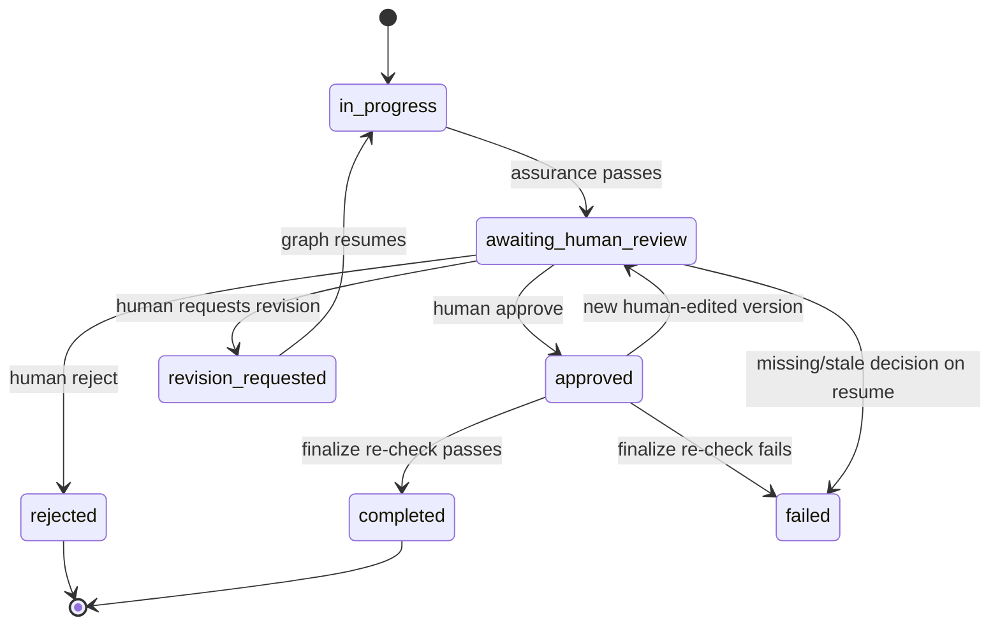

# Human Approval Design

**Control:** GR-01 — Human approval precedes finalization
**Implementation:** `aegisflow/approvals.py`, `aegisflow/graph/root.py`, `aegisflow/ui/review_page.py`
**Status:** implemented and verified (mock mode + headless UI flow)

---

## 1. Why a hash-bound approval?

A normal “approved” flag is too weak. It does not prove:

- **which exact text** was approved;
- whether the text changed after approval;
- whether the approval belongs to the current version;
- whether the approver was a human or an agent;
- whether the decision was persisted before the workflow resumed.

AegisFlow binds every approval to:

- the task id,
- the output version id,
- the SHA-256 hash of the version content,
- the reviewer name,
- an actor string beginning with `human:`,
- a timestamp.

Finalization and export recompute the hash and re-read the persisted decision. If anything is stale or changed, they refuse.

---

## 2. Approval state machine



`COMPLETED` and `REJECTED` are terminal. An edit to an approved task creates a new version and returns it to review; a completed task cannot be edited.

---

## 3. Writing a decision: `record_decision`

The UI is the only caller. It must pass `actor="human:streamlit"` (the module default is `human:local` for tests and scripts).

### 3.1 Checks, in order

| # | Check | Failure |
|---|---|---|
| 1 | `actor` starts with `human:` | `ApprovalError` — agents cannot approve |
| 2 | decision is approve/reject/request_revision | invalid enum error |
| 3 | reviewer name is non-empty | “A reviewer name is required.” |
| 4 | revision feedback is non-empty | “Revision feedback is required.” |
| 5 | task exists | “Task not found” |
| 6 | task status is `awaiting_human_review` | “Task is not awaiting human review” |
| 7 | version exists and belongs to the task | “Output version does not belong to this task.” |
| 8 | version is the current version | “This version is stale. Only the current output version can be reviewed.” |
| 9 | stored content matches its hash | “Output content hash mismatch; the version is corrupted.” |
| 10 | no prior approval of this version | “This version has already been approved.” |
| 11 | no duplicate identical decision | “Duplicate decision for this version.” |
| 12 | revision budget not exhausted | “Maximum revision cycles reached…” |
| 13 | task transition is allowed | “Invalid transition: …” |

### 3.2 Atomic write

One transaction performs every check, inserts the `human_reviews` row, updates `tasks.status`, and inserts a `human_decision` audit row. Either all of it succeeds or none does. Feedback is redacted before storage.

The checks live inside that transaction so two concurrent decisions cannot both validate and then both commit. A unique index, `uq_reviews_version_decision`, on `(version_id, decision)` is the database-level backstop for concurrent writers and direct SQL. Older databases that already contain duplicate rows skip index creation instead of failing to start.

### 3.3 Resulting status

| Decision | New task status |
|---|---|
| approve | `approved` |
| reject | `rejected` |
| request_revision | `revision_requested` |

---

## 4. Resume protocol

LangGraph's `Command(resume=decision)` is **not** accepted as proof of a human decision. The graph independently verifies the persisted record.

```python
# UI (review_page.py)
record_decision(db, task_id, version_id, decision, reviewer,
                feedback, actor="human:streamlit", max_revisions=...)
workflow.resume(task_id, {"decision": decision, "reviewer": reviewer, ...})
```

At `human_review` on resume:

| Action | Verification |
|---|---|
| approve | `assert_finalizable(task, version, hash)` must pass → `finalize` |
| reject | latest review for this version must be `reject` → `rejected` |
| request_revision | latest review must be `request_revision` → bounded loop |
| anything else | escalate with “Unknown human decision” |

If verification fails, the graph routes to `escalate`, sets `failed`, and writes an `approval_rejected` audit event. It does not finalize.

### Why persist first?

This prevents a forged resume payload from completing a task. It also makes every decision durable before any graph mutation, so a crash after the decision leaves a reviewable record rather than a lost approval.

### Crash recovery

If the UI records a decision but the graph resume fails (for example, the process dies), the task status reflects the recorded decision. For an approval, the graph is still interrupted at `human_review`; re-running the resume with the same decision will pass `assert_finalizable` and finalize. For a revision or rejection, the persisted decision remains in history; the operator should inspect the audit trail before retrying. The UI surfaces the exception rather than silently retrying.

---

## 5. Finalization re-verification

`assert_finalizable(db, task_id, version_id, content_hash)` requires all of:

1. task exists;
2. status is `approved` or `completed`;
3. `task.current_version_id == version_id`;
4. version exists;
5. `version.content_hash == content_hash`;
6. `sha256(version.content) == content_hash`;
7. the latest review for that version is `approve`;
8. the latest review's `content_hash == content_hash`.

It returns the approval record. `finalize` calls it before transitioning to `completed`; export calls it again before producing a file.

### Tamper detection

TC-10 approves a version, then directly updates `output_versions.content` to different text. The next resume and export both raise `ApprovalError` (“Stored content does not match its hash.”) and the task escalates. A stale hash supplied to export also fails.

This detects accidental or direct content modification, but **is not a digital signature**: a local attacker who rewrites both content and hash and inserts a matching review row can forge a record. The threat model below is explicit about this.

---

## 6. Version invalidation

`create_output_version`:

- refuses empty content;
- refuses a completed task;
- moves an `approved` task back to `awaiting_human_review`;
- inserts an immutable version row and points the task at it;
- records an audit event.

Consequences:

- the old approval no longer matches `task.current_version_id`;
- `assert_finalizable` and export refuse the old version;
- the UI must review the new version and record a new decision.

This is tested by TC-03 and `test_stale_version_rejected`.

---

## 7. Revision budget

`max_revisions` (default 2) is enforced in two places:

1. `record_decision` counts prior `request_revision` reviews and refuses another when the budget is exhausted.
2. The graph also checks `revision_count` against `max_revisions` and escalates if a revision is requested beyond the limit.

This double check prevents a bypass where a decision is written but the graph state is inconsistent. TC-05 verifies both the refusal and the escalation when an unpersisted revision is resumed.

---

## 8. UI walkthrough

1. The workflow reaches `human_review` and the UI shows **Human approval gate**.
2. The page displays:
   - version number, revision count, simulated flag, claim count;
   - the full content hash;
   - the draft (read-only), claims/evidence, policy findings, reviewer reasons, and decision history.
3. The reviewer enters their name, chooses a decision, optionally adds feedback and a revision target, and ticks **“I reviewed the exact version and content hash shown above.”**
4. On submit, the UI calls `record_decision` with `actor="human:streamlit"`.
5. Only after a successful write does it call `workflow.resume`.
6. Outcomes:
   - approve + finalize → flash “Approved version N and finalized the task”, navigate to Workflow;
   - reject → flash warning, task rejected;
   - revision + new interrupt → flash “A new output version is ready”, stay on Review;
   - revision + escalation → navigate to Workflow with the failure reason.

The UI never offers a generic “resume” button. Resuming without a persisted decision is intentionally unsupported.

---

## 9. Threat model

| Threat | Control | Residual |
|---|---|---|
| Agent calls `record_decision` | Actor prefix check; agents never import the module | A code change could bypass; reviewed in tests |
| Forged resume payload | Graph re-reads persisted review for the exact version | None found in tests |
| Replayed approval | Duplicate approval check; version/hash binding | Replay of an old version fails as stale |
| Approval after content edit | Current-version and hash checks | Local DB rewrite could forge both |
| Approval of wrong version | Version id + current version check | — |
| Local SQLite tampering | Hash detects content edits; audit records | Not cryptographically tamper-evident |
| UI crash between write and resume | Decision is already durable; recovery path documented | Operator must retry resume |
| Race between two approvals | Checks and writes share one transaction; unique `(version_id, decision)` index | Two concurrent approvals produce exactly one record (tested) |
| Impersonation of reviewer | Reviewer name is free text | No authentication in v1 |

### Explicit non-guarantees

- The `human:` actor prefix is an application convention, not an authenticated identity.
- The SHA-256 hash is an integrity check, not a signature or non-repudiation mechanism.
- A local administrator who can edit SQLite and the checkpointer can alter history.
- There is no separate approval service, hardware token, or second approver.

These are acceptable for a single-user academic prototype and are documented as such.

---

## 10. Error reference

| Error | Meaning | Correct action |
|---|---|---|
| `Only the human UI layer may record approval decisions` | Actor is not `human:*` | Fix the caller; agents must never approve |
| `Task is not awaiting human review` | Wrong lifecycle state | Refresh; inspect audit |
| `This version is stale` | A newer version exists | Review the current version |
| `Output content hash mismatch` | Stored content was altered | Investigate; do not export |
| `This version has already been approved` | Duplicate approval | No action; proceed to finalize/export |
| `Duplicate decision` | Same decision recorded twice | Refresh the page |
| `Maximum revision cycles reached` | Budget exhausted | Approve or reject |
| `Task is not approved` | Finalize/export before approval | Complete the human gate |
| `No valid human approval exists` | Missing/incorrect review | Do not finalize |
| `Stored content does not match its hash` | Tamper or corruption | Escalate and investigate |
| `A completed task cannot be edited` | Edit after finalization | Start a new task or revision cycle |

---

## 11. Test evidence

| Test | What it proves |
|---|---|
| `test_approve_and_finalize` | Approval → finalization |
| `test_agent_actor_cannot_approve` | Actor restriction |
| `test_duplicate_approval_rejected` | Replay protection |
| `test_stale_version_rejected` | Version invalidation |
| `test_hash_mismatch_rejected` | Hash binding |
| `test_stored_content_tamper_rejected` | Tamper detection |
| `test_reject_is_terminal` | Rejection terminal |
| `test_revision_requires_feedback_and_reaches_limit` | Feedback + budget |
| `test_concurrent_approvals_record_exactly_one` | Race hardening: one winner, one refusal |
| `test_unique_review_index_exists` / `test_unique_index_rejects_direct_duplicate` | Database backstop |
| TC-02 | No persisted decision → escalate |
| TC-03 | Edit invalidates prior approval |
| TC-04 | Rejection blocks export |
| TC-10 | Tampering blocks finalize/export |
| UI smoke test | Real Streamlit form writes the approval and finalizes |
