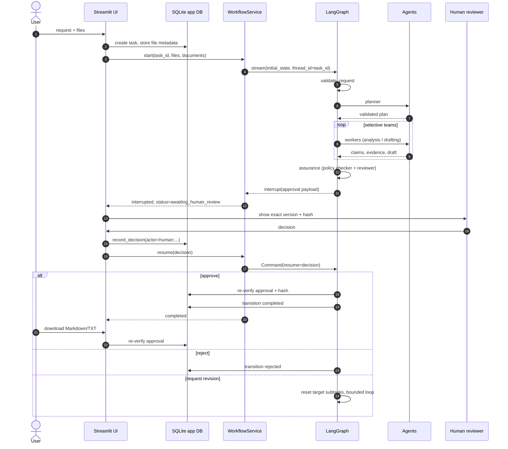

# AegisFlow Workflow and State Machine

This document describes exactly what happens between **request submission** and **approved export**, including routing rules, revision loops, failure paths, and the human interrupt.

---

## 1. End-to-end sequence



---

## 2. Phases and status values

| Phase | Typical `TaskStatus` | What is happening |
|---|---|---|
| `start` | `pending` | Task row created, files stored |
| `planning` | `planning` | Request validation, planner |
| `analysis` | `in_progress` | Document Analyst and optional Evidence Verifier |
| `drafting` | `in_progress` | Report Writer |
| `assurance` | `in_progress` | Policy Checker and Independent Reviewer |
| `human_review` | `awaiting_human_review` | LangGraph interrupt; UI decision |
| `finalize` | `approved` → `completed` | Approval re-check, elapsed time, completion |
| `rejected` | `rejected` | Terminal |
| `blocked` | `blocked` | Terminal; missing input or plan gap |
| `escalated` | `failed` | Terminal; retry/revision/worker limit |

`TaskStatus` transitions are enforced in `models.ALLOWED_TRANSITIONS` and `Database.transition_task`.

```text
pending ──► planning ──► in_progress ──► awaiting_human_review
   │            │             │                  │
   ├──► blocked ├──► blocked  ├──► blocked      ├──► approved ──► completed
   └──► failed  └──► failed   ├──► failed       ├──► rejected
                              └──► revision_requested
                                        │
                                        └──► in_progress
```

A human edit that creates a new output version moves an `approved` task back to `awaiting_human_review`, invalidating the previous approval. A `completed` task cannot be edited.

---

## 3. Planner

The planner is the **first and only mandatory model agent**. It receives:

- the request and output format
- file metadata (filename, status, pages, message) — **not** full text
- the validated skill catalog

It must return a `Plan` with:

- `task_type`: summary, report, meeting_brief, outline, or action_items
- `objective`
- `subtasks` with unique ids, one allowed agent, matching skill, and explicit dependencies
- `required_skills`
- `missing_information` and `clarification_questions`

Validation rejects unknown agents/skills, duplicate ids, unknown or self dependencies, cycles, unmet dependency order, a blocked plan with executable subtasks, and an analysis subtask with no readable file.

### Default mock plans

| Request signal | Subtasks |
|---|---|
| “summary”, “summarize” | `document_analyst` |
| “outline” | `document_analyst` → `report_writer` |
| “brief”, “meeting”, “report”, action items, default | `document_analyst` → `evidence_verifier` → `report_writer` |
| no readable file | no subtasks; `missing_information` populated |

---

## 4. Orchestrator routing

The orchestrator is deterministic and makes no model calls. Every choice is checked against the whitelist:

```text
analysis_team, drafting_team, assurance_team, human_review, blocked, escalate
```

| Precondition | Destination | Reason |
|---|---|---|
| upstream status `failed` | `escalate` | Upstream node failed |
| upstream status `blocked` | `blocked` | Upstream blocked |
| no plan | `blocked` | No validated plan |
| plan has `missing_information` | `blocked` | Explicit plan gap |
| analysis needed and not complete | `analysis_team` | Analysis subtasks pending (run limit 4) |
| analysis team blocked | `blocked` | Blocking input problem |
| analysis team escalated / run limit | `escalate` | Worker failure or limit |
| writer needed and not complete | `drafting_team` | Writer subtask pending (run limit 4) |
| drafting team blocked / escalated | `blocked` / `escalate` | Input or worker failure |
| no draft after selected teams | `blocked` | Nothing to assure |
| assurance not complete | `assurance_team` | Policy + independent review (run limit 4) |
| assurance `needs_revision`, budget left | `drafting_team` | Bounded revision with feedback |
| assurance `needs_revision`, budget exhausted | `escalate` | Maximum revisions reached |
| assurance escalated | `escalate` | Reviewer failure |
| no version id/hash | `escalate` | Cannot open the human gate |
| ready | `human_review` | Status set to `awaiting_human_review` |

Every routing decision writes:

- a `routing_log` entry (`from_node`, `to_node`, reason, rule `GR-06`, depth)
- an `audit_log` row (`routing_decision`, actor `system:orchestrator`)
- the whitelist is enforced by `validate_routing_choice`; an invalid choice becomes `escalate`

---

## 5. Team leads and workers

### Analysis team

```text
analysis_lead → document_analyst → analysis_lead → evidence_verifier → analysis_lead → END
```

- Refuses to run without readable document text (team `blocked`).
- Runs the analyst only if its subtask is pending/incomplete.
- Runs the verifier only if it exists in the plan and claims exist.
- Propagates a worker failure as team `escalated`.
- Internal delegation limit: 8 iterations.

### Drafting team

```text
drafting_lead → report_writer → drafting_lead → END
```

- Requires claims or an analysis summary (otherwise `blocked`).
- Marks writer subtasks complete after a validated draft.
- Propagates writer failure as `escalated`.
- Internal delegation limit: 6 iterations.

### Assurance team

```text
assurance_lead → policy_checker → assurance_lead → reviewer → assurance_lead → END
```

- Requires a non-empty draft (otherwise `blocked`).
- Policies always run before the reviewer.
- Pass requires **both** `policy_report.passed` and `review_result.decision == "pass"`.
- A failure becomes `needs_revision` until the revision budget is exhausted.
- Internal delegation limit: 6 iterations.

### Agent retries

`call_agent` performs `max_retries + 1` attempts (default 3 total). It classifies failures as transient, malformed output, missing input, policy violation, configuration, or unknown, writes exactly one `agent_executions` row per completed/failed call, and raises `AgentFailure` after the final attempt.

---

## 6. Assurance checks

### Deterministic policy checker

Commanded by `run_policy_checks(draft, plan, claims, source_text, simulated)`:

1. Required sections: Summary, Key Findings, Sources, Limitations.
2. Every claim line has `[S#]` or `[UNVERIFIED]`.
3. Unsupported/conflicting claims are labeled.
4. No surviving instruction-like text or `<untrusted_document` delimiter.
5. No secret-like values in the draft.
6. No newly invented email addresses; source-provided contact information is a warning.
7. No claim that an external action was performed.
8. Simulated output carries a label.
9. Missing-information plans have a limitations section.

High-severity findings block the draft; warnings are shown to the human.

### Independent reviewer

The reviewer checks completeness, traceability, claim-status consistency, policy consistency, visible limitations, and absence of external-action claims. It returns `pass`, `needs_revision`, or `fail` with reasons. It never rewrites the draft.

---

## 7. Revision paths

There are two different revision loops.

### 7.1 Assurance-driven revision (automatic, bounded)

Triggered when policy or review fails inside the assurance team.

```text
revision_count += 1
feedback = high-severity policy findings + reviewer issues
reset writer subtask to pending
clear draft, policy report, review result
route to drafting_team
```

If `revision_count >= max_revisions`, the task escalates instead. Default `max_revisions = 2`.

### 7.2 Human-requested revision (UI decision)

The human chooses a target:

- **drafting** — rewrite the deliverable from existing verified claims.
- **analysis** — re-extract and re-verify claims (also clears claims/evidence/summary).

The graph requires a **persisted** `request_revision` review for the current version before it will act. It increments `revision_count`, resets the relevant subtasks, and routes back through the orchestrator. A new output version is created, which invalidates the prior approval.

If the revision budget is exhausted, the UI refuses to record another revision and the graph escalates.

---

## 8. Human interrupt and resume

At `human_review`, the graph calls `interrupt(payload)` and stops. The payload includes:

- task id, request, draft
- claims and evidence
- policy report and review result
- version id, version number, content hash
- simulated flag, revision count, max revisions
- previous human decisions

`WorkflowService.start/resume` streams graph updates, captures the interrupt value, and returns a `RunResult` with `interrupted`, `interrupt_payload`, `status`, and `next_nodes`.

**The resume contract is strict:**

1. The UI must persist the decision with `record_decision(...)`.
2. Only then may it call `workflow.resume(...)`.
3. The graph re-reads the persisted decision for the exact version.
4. Missing or mismatched records cause escalation, never finalization.

Approval behavior:

| Decision | Persisted state | Graph behavior |
|---|---|---|
| approve | `approved` | `assert_finalizable` → `finalize` → `completed` |
| reject | `rejected` | `rejected` node (terminal) |
| request revision | `revision_requested` | reset target, bounded loop |
| approve without record | unchanged | escalate |
| reject without record | unchanged | escalate |
| revision without record | unchanged | escalate |

---

## 9. Finalization and export

`finalize` runs `assert_finalizable` again:

- task status is `approved` or `completed`
- the approved version is still the current version
- the stored content matches its SHA-256 hash
- the latest review for that version is `approve`
- the approval record's hash equals the content hash

It then records elapsed time and transitions to `completed`.

`export_markdown` / `export_txt` call the same function. A stale, edited, rejected, or tampered version cannot be exported as approved. Exports include version, hash, reviewer, approval timestamp, and simulated status.

---

## 10. Failure and escalation matrix

| Condition | Result | Audit evidence |
|---|---|---|
| Request < 8 chars / bad format | `blocked` | `request_blocked` |
| Files exist but none readable | `blocked` | `request_blocked` |
| No files supplied | `blocked` via planner | `plan_blocked` |
| Plan missing information | `blocked` | `plan_blocked` |
| No claims for verifier | analysis `blocked` | team routing log |
| No draft for assurance | assurance `blocked` | team routing log |
| Agent retries exhausted | team `escalated` | `agent_failed`, `task_escalated` |
| Assurance fails, budget left | drafting revision | `routing_decision` |
| Assurance fails, budget exhausted | `failed` | `task_escalated` |
| Human revision budget exhausted | `failed` | `task_escalated` |
| Approval missing/stale/tampered | `failed` | `approval_rejected` |
| Human rejects | `rejected` | `task_rejected`, `human_decision` |
| Recursion limit reached | LangGraph stop | checkpoint + audit history |

---

## 11. Worked examples

### Example A — summary, selective routing

Request: “Please summarize the attached project notes.”

```text
validate → planner [document_analyst]
→ orchestrator → analysis_team
→ root wrapper creates a versioned summary draft [agent]
→ orchestrator → assurance_team (policy + reviewer)
→ orchestrator → human_review
```

No `evidence_verifier` or `report_writer` execution rows are created. Verified by `test_tc13_selective_routing_summary_uses_analyst_only`.

### Example B — report with approval

Request: “Please prepare a meeting report from these notes.”

```text
validate → planner [analyst, verifier, writer]
→ analysis_team (analyst + verifier)
→ drafting_team (writer) → output version 1
→ assurance_team (policy + reviewer)
→ human_review [interrupt]
→ UI records approve → resume
→ finalize re-checks hash → completed
→ export Markdown/TXT
```

Verified by `test_tc01_happy_path_approval_finalize_and_export`.

### Example C — rejection

```text
human_review → UI records reject → resume
→ rejected node → status rejected
→ export raises ApprovalError
```

Verified by `test_tc04_reject_is_terminal_and_blocks_export`.

---

## 12. Limits (defaults)

| Limit | Default | Enforced in |
|---|---|---|
| Agent retries | 2 (3 attempts) | `call_agent` |
| Analysis team runs | 4 | `orchestrator` |
| Drafting team runs | 4 | `orchestrator` |
| Assurance team runs | 4 | `orchestrator` |
| Analysis lead iterations | 8 | `leads.analysis_lead` |
| Drafting lead iterations | 6 | `leads.drafting_lead` |
| Assurance lead iterations | 6 | `leads.assurance_lead` |
| Human/assurance revisions | 2 | `approvals`, `orchestrator`, `leads` |
| LangGraph recursion | 80 | `WorkflowService` config |
| File size | 10 MB | `document_processing` |

All limits are configurable via environment variables except the lead iteration limits, which are fixed for safety in v1.
